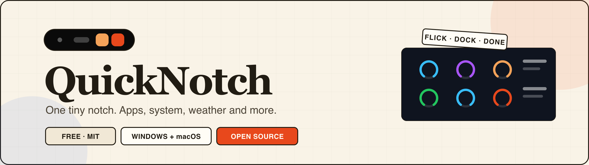

# QuickNotch



**A floating notch and app dock for Windows and macOS.** Hover the pill at the top of
your screen and it opens into a dock of pinned apps; scroll and it turns into pages for
your machine, the sky, your day and your music. Free, MIT licensed, no account, no
telemetry.

[](https://github.com/StarkDroid/QuickNotch/releases)
[](https://github.com/StarkDroid/QuickNotch/releases)
[](LICENSE)

[](#install)
[](#install)
[](https://kotlinlang.org)
[](https://www.jetbrains.com/lp/compose-multiplatform/)

**[Download](https://quicknotch.app/download)** ·
[Website](https://quicknotch.app) ·
[Changelog](https://quicknotch.app/changelog) ·
[Releases](https://github.com/StarkDroid/QuickNotch/releases) ·
[Report a bug](https://github.com/StarkDroid/QuickNotch/issues)

[](https://ko-fi.com/I2I41TRI2M)

---

## What it does

QuickNotch is one small pill pinned to the top-centre of the screen. Hover it and a dock
of pinned apps grows out of it, leaning toward the cursor so a click always lands where
you expect. Scroll over it and the same island turns into another page — no window to
arrange, no tab to find, nothing to dismiss.

| State | What you get |
| :--- | :--- |
| **Quickview** (collapsed) | Date and time, weather, laptop and device battery, unread notifications. While music plays it becomes a vinyl disc with a marquee title and a live waveform. |
| **Apps** | Fisheye dock of pinned apps, one click to launch. |
| **System** | CPU, GPU, memory, storage, download and upload as live rings; click through to Task Manager or Activity Monitor. |
| **Weather** | Today plus a seven-day outlook, automatic by IP or pinned to a town you choose. |
| **Calendar** | Google Calendar for the day, with the next event ticking along in the pill. |
| **Music** | Cover art, progress, transport and volume — Windows media sessions, or MediaRemote on macOS. |
| **Gaming** (Windows) | A fullscreen game replaces the pill with FPS, CPU, GPU, ping and download; each cell can be switched off. |

The notch sits flush above the menu bar on macOS and above fullscreen games on Windows,
and it stays quiet: the Dock icon (on macOS) and taskbar presence appear only while
Settings is open.

## Install

Grab the installer for your machine from **[quicknotch.app/download](https://quicknotch.app/download)**
or the [latest release](https://github.com/StarkDroid/QuickNotch/releases/latest):

| Platform | File |
| :--- | :--- |
| Windows 10 & 11 (x64) | `.msi` (or `.exe`) |
| macOS 12+ Apple silicon | `-arm64.dmg` |
| macOS 12+ Intel | `-x64.dmg` |

The builds are not code-signed yet, so Windows SmartScreen and macOS Gatekeeper will ask
once — *More info → Run anyway* on Windows, right-click → *Open* on macOS. Once installed,
QuickNotch updates itself: it checks GitHub in the background and swaps in the next
release after you press **Restart & update** in **Settings → Changelog**.

## Build from source

You need **JDK 17+**. Everything else is downloaded by Gradle. macOS builds also compile
the small Objective-C bridges (`cc` is part of the Xcode command-line tools).

```bash
git clone https://github.com/StarkDroid/QuickNotch.git
cd QuickNotch
./gradlew :composeApp:run                      # launch overlay + tray
./gradlew :composeApp:compileKotlinDesktop     # fast type check
./gradlew :composeApp:detekt                   # static analysis (must be green)
./gradlew :composeApp:packageDistributionForCurrentOS   # installer for this OS
```

On Windows use `gradlew.bat`. Installers land in
`composeApp/build/compose/binaries/main/` (`.msi`/`.exe`, or `.dmg` plus
`app/QuickNotch.app` via `:composeApp:createDistributable`).

Run the app with `:composeApp:run`, not `java -jar` — the plain jar has no manifest and
the bridges are synced by the build.

Calendar sign-in needs a Google OAuth client, and this repository carries
neither half of it: the client id names this project's client, the secret
authenticates it. Official installers get both from CI. For a local build, put
them in the ignored `local.properties`:

```properties
googleClientId=...apps.googleusercontent.com
googleClientSecret=GOCSPX-...
```

or export `QUICKNOTCH_GOOGLE_CLIENT_ID` and
`QUICKNOTCH_GOOGLE_CLIENT_SECRET` before building. Everything else works
without them; Calendar then reports that the build has no Google client. If you
are forking, create your own client in the Google Cloud console and use its
values.

The website has its own build entry at the repository root: `npm run build`
installs and builds `web/`, and `npx wrangler deploy` publishes it to
`quicknotch.app`. Those are the same two commands Cloudflare runs, so see
`web/README.md` before changing either.

## Project layout

```
composeApp/     Kotlin + Compose Multiplatform desktop app
  src/commonMain     pure Kotlin: calendar + weather APIs, strings, glyphs
  src/desktopMain    overlay, dock, widgets, media, system probes, settings
  native/            Win32 PowerShell bridges and macOS Objective-C bridges
web/            SvelteKit marketing site (static, prerendered, Cloudflare Workers)
docs/           banner sources for the README
config/         detekt configuration and baseline
```

The app is documented where it lives: `main.kt` for the process and window model,
`system/` for the per-platform probes, `FloatingNotchOverlay` for the overlay
choreography, and the media, calendar and weather packages for the rest. The
comments carry the reasons, including the traps that cost a day. Read those before
changing anything under `ui/` or `system/`.

## How releases work

Every merged pull request that touches the app becomes a release. The workflow plans the
next version from the PR's labels, builds the Windows installers and both macOS DMGs,
then publishes them with `SHA256SUMS.txt` and a cumulative `changelog.json` — the same
feed the app and the [website changelog](https://quicknotch.app/changelog) read.

| Label | Bump |
| :--- | :--- |
| `release:major`, `major`, `breaking` | major |
| `release:patch`, `patch`, `fix`, `bug` | patch |
| anything else | minor |

A PR that only touches `web/`, docs or CI merges without producing a build. Local builds
report `2.0.0` unless CI passes the published number with `-PappVersion=x.y.z`.

## Contributing

1. Branch from `main`, keep one logical change per commit, and sign your commits
   (`git commit -S`).
2. `./gradlew :composeApp:compileKotlinDesktop :composeApp:detekt` must pass; run
   `:composeApp:run` and check the notch before you open the PR.
3. A feature ships on three surfaces — the overlay, the onboarding walkthrough and
   `web/` — in the same pull request, all telling the same story.
4. Nothing is pushed for you: open the PR from your own fork or branch.

Issues and ideas are welcome at
[github.com/StarkDroid/QuickNotch/issues](https://github.com/StarkDroid/QuickNotch/issues).

## Licence

MIT — see [LICENSE](LICENSE). Use it, fork it, ship your own notch.

QuickNotch is free and has no upsell. If it earns a place on your screen and you feel
like saying thanks, [buy me a coffee](https://ko-fi.com/trishiraj) — it keeps the updates
coming and unlocks nothing.
